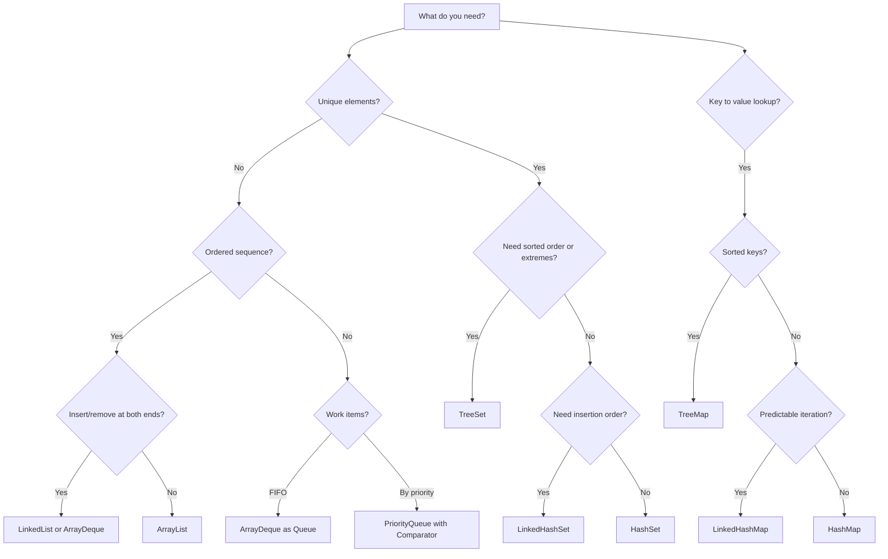

# Java Collections in the Banking Simulator

This is a small Java 21 console application that models customers, accounts, transactions, and banking requests. Its purpose here is study: each collection in the code solves a specific problem — append-only transaction history, duplicate detection, insertion-ordered "recent" views, sorted lookups, FIFO work queues, priority work queues, and bounded activity logs. The README explains what is actually implemented in `src/com/yarez/banking`, with real code and real console output. It also states the costs of each choice and where the current code has rough edges.

## Table of contents

1. [Quick start](#3-quick-start)
2. [Project structure](#4-project-structure)
3. [Collections at a glance](#5-collections-at-a-glance)
4. [Collection families in detail](#6-collection-families-in-detail)
   - [Lists](#61-lists)
   - [Sets](#62-sets)
   - [Maps](#63-maps)
   - [Queues and deques](#64-queues-and-deques)
   - [Utilities: ordering and immutability](#65-utilities-ordering-and-immutability)
5. [Money and keys](#7-money-and-keys)
6. [Concurrency and collections](#8-concurrency-and-collections)
7. [Streams and Collectors](#9-streams-and-collectors)
8. [Decision guide](#10-decision-guide)
9. [Review notes](#11-review-notes)
10. [Not covered yet](#12-not-covered-yet)
11. [Study plan and exercises](#13-study-plan-and-exercises)
12. [References](#14-references)

## 3. Quick start

### Verified environment

| Item | Verified value |
| --- | --- |
| Java | `java version "21.0.5"`, `javac 21.0.5` |
| Maven | `Apache Maven 3.9.12` |
| Build file | `pom.xml` (Java 21, UTF-8, JUnit Jupiter 5.10.2, Surefire 3.2.5) |
| Tests | `src/test/java/com/yarez/banking` (18 JUnit 5 tests) |
| Entry point | `com.yarez.banking.Main` (`public static void main`) |
| Source root | `src` (configured in `pom.xml`; the compiler excludes `src/test/java`) |

### Maven build, tests, and run

Run these from the repository/worktree root:

```powershell
mvn -q compile
mvn -q test
java -cp target/classes com.yarez.banking.Main
```

`mvn -q test` is green. To see the test totals and individual class names, run `mvn test`. To run one tutorial test at a time, for example while studying the red-then-green commits:

```powershell
mvn -q test -Dtest=BankAccountEqualityTest
mvn -q test -Dtest=PriorityBankingRequestQueueTest
mvn -q test -Dtest=BigDecimalMoneyTest
```

### javac/java fallback

The program still compiles and runs without Maven. The output directory is outside the repository, so no generated `.class` files are added to Git. Any writable directory can be used instead.

```powershell
$classes = 'C:\Users\Yarez\AppData\Local\Temp\opencode\banking-classes'
New-Item -ItemType Directory -Force -Path $classes | Out-Null
$sources = Get-ChildItem -Path src -Recurse -Filter *.java |
    Where-Object { $_.FullName -notmatch '\\test\\' } |
    ForEach-Object { $_.FullName }

javac -encoding UTF-8 -d $classes $sources
java -cp $classes com.yarez.banking.Main
```

Result: `javac` exited `0` with no warnings, and `java` exited `0`. The run printed 184 lines. The baseline was captured in `banking-baseline-18.log` before the fixes; after every fix, the output matched it after replacing runtime-generated UUIDs and ISO timestamps with `<UUID>` and `<TIMESTAMP>`. No behavior line changed. All console output quoted later in this README comes from that capture on 2026-11-28. UUIDs and `LocalDateTime` values are generated at runtime and will differ on your machine.

## 4. Project structure

```text
java-core-banking-simulator/
├── .gitignore                         # ignores .idea/, *.iml, out/, target/, *.class
├── README.md                          # this study guide
├── pom.xml                            # Java 21, JUnit 5, source root src
├── java-core-banking-simulator.iml    # IntelliJ module; marks src as the source root
└── src/
    ├── com/yarez/banking/
    │   ├── Main.java                      # entry point; runs all 16 demonstrations
    │   ├── BankAccount.java               # ArrayList history, Comparable, equals/hashCode
    │   ├── BankTransaction.java           # immutable transaction record-like class
    │   ├── Customer.java                  # immutable customer value object
    │   ├── Money.java                     # BigDecimal build/format helper (scale 2, HALF_EVEN)
    │   ├── AccountRegistry.java           # HashMap<Long, BankAccount>
    │   ├── RecentAccountRegistry.java     # LinkedHashMap<Long, BankAccount>
    │   ├── SortedAccountRegistry.java     # TreeMap<Long, BankAccount>
    │   ├── TransactionRegistry.java       # HashSet<String> of transaction IDs
    │   ├── RecentTransactionRegistry.java # LinkedHashSet<String> of transaction IDs
    │   ├── SortedTransactionRegistry.java # NavigableSet<String> backed by TreeSet
    │   ├── BankingRequest.java            # FIFO request value object
    │   ├── BankingRequestQueue.java       # ArrayDeque as Queue<BankingRequest>
    │   ├── PriorityBankingRequest.java    # request plus RequestPriority
    │   ├── PriorityBankingRequestQueue.java # PriorityQueue with FIFO tie-break
    │   ├── RequestPriority.java           # enum HIGH, NORMAL, LOW
    │   ├── RecentActivityManager.java     # ArrayDeque as bounded Deque<BankTransaction>
    │   ├── AccountSorting.java            # Comparator/Comparable sorting of accounts
    │   └── TransactionSorting.java        # Comparator sorting of transactions
    └── test/java/com/yarez/banking/
        ├── BankAccountEqualityTest.java
        ├── PriorityBankingRequestQueueTest.java
        ├── SortedTransactionRegistryTest.java
        ├── RegistryDuplicateRegistrationTest.java
        ├── CustomerImmutabilityTest.java
        ├── MoneyCharacterizationTest.java
        ├── BigDecimalMoneyTest.java
        └── TransactionSortingTest.java
```

All production classes are in the single package `com.yarez.banking`; the tests mirror that package. There is no REST layer, database, or concurrency layer.

## 5. Collections at a glance

Every collection type used in the code is listed below. "Declared as" shows whether the field or local variable uses an interface or a concrete class. All accesses are from the single `main` thread.

| Collection | Declared as | Where used (file) | Banking use case | Why this choice | Time complexity of operations used here | Thread-safety note |
| --- | --- | --- | --- | --- | --- | --- |
| `List` | Interface: `List<BankTransaction>`, `List<BankAccount>` | `BankAccount.java`, `RecentActivityManager.java`, `Main.java`, `AccountSorting.java`, `TransactionSorting.java` | Transaction history, immutable snapshots, sortable working lists | Ordered sequence with iteration and in-place sorting | `add` end amortized O(1); indexed `get` O(1) on `ArrayList` / O(n) on `LinkedList`; full iteration O(n); `sort` O(n log n) worst; `List.copyOf` O(n) | Not thread-safe; no concurrent access |
| `ArrayList` | Concrete backing for `List` | `BankAccount.java`, `Main.java` | Append-only history and mutable copies for sorting | Contiguous array: compact, cache-friendly, O(1) indexed access | `add` end amortized O(1); iteration O(n); `sort` O(n log n) | Not thread-safe |
| `LinkedList` | Concrete local variable | `Main.java` | Step list and pending-request examples using both ends | `addFirst`/`removeFirst`/`addLast`/`removeLast` are O(1) | End insert/remove O(1); iteration O(n); `getFirst`/`getLast` O(1) | Not thread-safe |
| `Set` | Interface: `Set<String>` | `TransactionRegistry.java`, `RecentTransactionRegistry.java` | Unique transaction IDs | Membership without duplicates | Same as backing implementation | Depends on implementation; all usages single-threaded |
| `NavigableSet` | Interface: `NavigableSet<String>` | `SortedTransactionRegistry.java` | Sorted transaction IDs with `first()`/`last()` | Declares the sorted-order requirement without a cast | Same as `TreeSet` backing | Not thread-safe |
| `HashSet` | Concrete backing for `Set` | `TransactionRegistry.java` | Reject duplicate transaction IDs | No order needed; average O(1) `add`/`contains` | `add`, `contains`, `size` average O(1); iteration O(n) | Not thread-safe |
| `LinkedHashSet` | Concrete backing for `Set` | `RecentTransactionRegistry.java` | Recent transaction IDs in registration order | Keeps insertion order without sorting | `add`, `contains`, `remove` average O(1); iteration O(n) | Not thread-safe |
| `TreeSet` | Concrete backing for `NavigableSet` | `SortedTransactionRegistry.java` | Sorted transaction IDs and first/last ID | Maintains sorted order; exposes `first()`/`last()` | `add`, `contains`, `remove` O(log n); `first`/`last` O(log n); iteration O(n) | Not thread-safe |
| `Map` | Interface: `Map<Long, BankAccount>` | `AccountRegistry.java`, `RecentAccountRegistry.java` | Account number → account lookup | Key-based lookup | Same as backing implementation | Depends on implementation; all usages single-threaded |
| `HashMap` | Concrete backing for `Map` | `AccountRegistry.java` | General account registry | No ordering requirement; average O(1) lookup | `put`, `get`, `containsKey`, `remove` average O(1); iteration O(n) | Not thread-safe |
| `LinkedHashMap` | Concrete backing for `Map` | `RecentAccountRegistry.java` | Recently registered accounts in insertion order | Predictable iteration order for display | `put`, `get`, `containsKey`, `remove` average O(1); iteration O(n) | Not thread-safe |
| `TreeMap` | Concrete class declared directly | `SortedAccountRegistry.java` | Account numbers sorted with `firstKey()`/`lastKey()` | Sorted keys and cheap extremes | `put`, `get`, `containsKey`, `remove` O(log n); `firstKey`/`lastKey` O(log n); iteration O(n) | Not thread-safe |
| `Queue` | Interface: `Queue<BankingRequest>` | `BankingRequestQueue.java` | FIFO pending requests | Poll in arrival order | `offer`, `poll`, `peek` O(1); iteration O(n) | Not thread-safe |
| `Deque` | Interface: `Deque<BankTransaction>` | `RecentActivityManager.java` | Bounded newest-first activity log | Add newest at front, evict oldest at back | `addFirst`, `removeLast`, `peekFirst` O(1); iteration O(n) | Not thread-safe |
| `ArrayDeque` | Concrete backing for `Queue` and `Deque` | `BankingRequestQueue.java`, `RecentActivityManager.java` | FIFO queue and bounded recent-activity deque | Resizable circular array; no per-node allocation | End operations amortized O(1); iteration O(n) | Not thread-safe |
| `PriorityQueue` | Concrete class declared directly | `PriorityBankingRequestQueue.java` | Requests ordered by `RequestPriority`, then FIFO sequence | Binary heap gives priority order on `poll`; a monotonic sequence breaks equal-priority ties | `offer`/`poll` O(log n); `peek` O(1); iteration O(n) | Not thread-safe |
| `Comparable` | Interface implemented by `BankAccount` | `BankAccount.java` | Natural order by account number | Enables `Comparator.naturalOrder()` | `compareTo` O(1) | Stateless |
| `Comparator` | Interface / factory methods | `AccountSorting.java`, `TransactionSorting.java`, `PriorityBankingRequestQueue.java` | Alternate sort orders and priority order | Separates ordering from the domain class | Key extraction O(1); `List.sort` O(n log n) worst | Stateless |

`Money.java` uses `BigDecimal` with scale 2 and `RoundingMode.HALF_EVEN`, and the three account registries use `putIfAbsent`. Records, streams, `Collectors`, `Collections.*`, `Arrays.*`, explicit `Iterator`/`ListIterator`, `removeIf`, `computeIfAbsent`, `merge`, `getOrDefault`, and `replaceAll` are **not used** in production code. The `Not covered yet` section mentions those only as suggestions.

## 6. Collection families in detail

All scenarios below run on one thread: `Main.main` constructs the objects, calls methods, and prints results. No collection is shared between threads.

### 6.1 Lists

#### How lists work here

`ArrayList` stores elements in a contiguous `Object[]`. Appending is amortized O(1) because the array grows (roughly 1.5x) only when capacity is exhausted; indexed access is O(1); insertion or removal in the middle shifts elements and is O(n). `LinkedList` is a doubly linked sequence of nodes. It inserts and removes at either end in O(1), but iteration has poorer locality and each element costs a node object plus two references. `List.copyOf` makes an immutable **snapshot**: later changes to the source list are not visible, and `null` elements are rejected.

#### 6.1.1 `BankAccount` transaction history

`src/com/yarez/banking/BankAccount.java`

```java
public class BankAccount implements Comparable<BankAccount> {
    private final List<BankTransaction> transactions = new ArrayList<>();
```

`src/com/yarez/banking/BankAccount.java`

```java
        BankTransaction deposit = new BankTransaction(
               UUID.randomUUID(),// System.currentTimeMillis(),
                "DEPOSIT",
                value,
                LocalDateTime.now(),
                balance
        );
        transactions.add(deposit);
```

The account appends one `BankTransaction` per successful deposit or withdrawal and displays them in insertion order. `ArrayList` fits because the operations are append, iterate, and snapshot — never middle insertion or indexed deletion. `LinkedList` would make append O(1) too, but would add node allocation and worse cache locality; `ArrayDeque` would be a reasonable alternative if only end access were needed, but the code also wants `List.copyOf` and `List.sort` compatibility.

Costs: `add` at the end amortized O(1); iteration O(n); `displayTransactionHistory` O(n); `List.copyOf` O(n).

Captured output from `Main` after `deposit(Money.of("2500"))`, `withdraw(Money.of("3000"))`, `withdraw(Money.of("6000"))`, `withdraw(Money.of("5001"))`, and `withdraw(Money.of("5000"))`:

```text
Deposit successful.
Withdrawal successful.
Withdrawal exceeds the maximum limit of 5000
Withdrawal exceeds the maximum limit of 5000
Withdrawal successful.
===== Transaction History =====
BankTransaction{transactionId=0fcc0988-29b9-4114-82e5-560bc1837f82, type='DEPOSIT', amount=2500, timestamp=2026-11-28T13:25:30.848638400, balanceAfter=12500}
BankTransaction{transactionId=2979adec-b257-4ec3-8941-4e16f2f6da6c, type='WITHDRAWAL', amount=3000, timestamp=2026-11-28T13:25:30.848638400, balanceAfter=9500}
BankTransaction{transactionId=2af7b09a-104d-4f54-99dd-be3a09c05166, type='WITHDRAWAL', amount=5000, timestamp=2026-11-28T13:25:30.848638400, balanceAfter=4500}
```

#### 6.1.2 Step list using `LinkedList<String>`

`src/com/yarez/banking/Main.java`

```java
        LinkedList<String> bankingOperations = new LinkedList<>();

        bankingOperations.add("Verify customer");
        bankingOperations.add("Validate account");
        bankingOperations.add("Process deposit");

        bankingOperations.addFirst("Authenticate customer");
        bankingOperations.addLast("Generate receipt");

        bankingOperations.removeFirst();
        bankingOperations.removeLast();
```

This sequence demonstrates adding and removing at both ends. `LinkedList` makes all four end operations O(1). With `ArrayList`, `addFirst`/`removeFirst` would shift every element, O(n). The trade-off is that random access `get(i)` would be O(n) on `LinkedList`, but this code only uses `getFirst`, `getLast`, and iteration.

Costs: `addLast`, `addFirst`, `removeFirst`, `removeLast`, `getFirst`, `getLast` O(1); printing all operations O(n).

```text
===== Banking Operations =====
First operation: Verify customer
Last operation: Process deposit
All operations: [Verify customer, Validate account, Process deposit]
```

#### 6.1.3 `LinkedList<BankingRequest>` for pending requests

`src/com/yarez/banking/Main.java`

```java
        LinkedList<BankingRequest> pendingRequests = new LinkedList<>();

        pendingRequests.addLast(
                new BankingRequest(1001, "John", "DEPOSIT", Money.of("5000"))
        );

        pendingRequests.addLast(
                new BankingRequest(1002, "Mary", "WITHDRAWAL", Money.of("2000"))
        );

        pendingRequests.addLast(
                new BankingRequest(1003, "David", "TRANSFER", Money.of("3000"))
        );
```

The list represents requests waiting for a bank teller, appended at the tail and read by iteration. The same end-operation argument applies: `LinkedList` gives O(1) appends and no shifting. For a real FIFO processor, `ArrayDeque` (section 6.4.1) is the better fit because it exposes `poll` and avoids node allocations; this `LinkedList` is here to show the list operations.

Costs: `addLast` O(1); iteration O(n).

```text
===== Pending Banking Requests =====
BankingRequest{requestId=1001, customerName='John', operationType='DEPOSIT', amount=5000}
BankingRequest{requestId=1002, customerName='Mary', operationType='WITHDRAWAL', amount=2000}
BankingRequest{requestId=1003, customerName='David', operationType='TRANSFER', amount=3000}
```

#### 6.1.4 Mutable `ArrayList` of accounts for sorting

`src/com/yarez/banking/Main.java`

```java
        List<BankAccount> accounts = new ArrayList<>();

        accounts.add(account3);
        accounts.add(account1);
        accounts.add(account2);

        // 1. Sort by natural ordering (account number)
        accountSorting.sortByAccountNumber(accounts);
        accountSorting.displayAccounts(accounts);
```

`List.sort` mutates the list in place, so the code needs a mutable `List`. `ArrayList` is the natural choice: key extraction is O(1) and TimSort needs random access. A `LinkedList` can be sorted, but it is slower to access during merging and uses more memory. `List.of(...)` would be immutable and could not be sorted in place.

Costs: three `add` calls amortized O(1) each; each sort O(n log n) worst case (O(n) when already nearly ordered); display O(n).

Captured output after the natural-order sort and after the balance-descending sort:

```text
Accounts sorted by account number.
===== Sorted Bank Accounts =====
Account Number: 10000001 | Customer: John | Balance: 15000
Account Number: 10000002 | Customer: Mary | Balance: 25000
Account Number: 10000003 | Customer: David | Balance: 35000
```

```text
Accounts sorted by balance (descending).
===== Sorted Bank Accounts =====
Account Number: 10000003 | Customer: David | Balance: 35000
Account Number: 10000002 | Customer: Mary | Balance: 25000
Account Number: 10000001 | Customer: John | Balance: 15000
```

#### 6.1.5 Copying an immutable snapshot back into a mutable list

`src/com/yarez/banking/Main.java`

```java
        // getTransactionHistory() returns an immutable copy.
        // Create a mutable ArrayList before sorting.
        List<BankTransaction> transactions =
                new ArrayList<>(account.getTransactionHistory());

        // 5. Sort transactions by amount (ascending)
        transactionSorting.sortByAmountAscending(transactions);
```

`BankAccount.getTransactionHistory()` returns `List.copyOf(transactions)`, which is immutable. Sorting it in place would throw `UnsupportedOperationException`, so `Main` constructs a new `ArrayList` from the snapshot. This preserves the invariant that callers cannot mutate the account's own history.

Costs: the copy constructor is O(n); the subsequent sort is O(n log n) worst case.

```text
Transactions sorted by amount (ascending).
===== Sorted Bank Transactions =====
BankTransaction{transactionId=0fcc0988-29b9-4114-82e5-560bc1837f82, type='DEPOSIT', amount=2500, timestamp=2026-11-28T13:25:30.848638400, balanceAfter=12500}
BankTransaction{transactionId=2979adec-b257-4ec3-8941-4e16f2f6da6c, type='WITHDRAWAL', amount=3000, timestamp=2026-11-28T13:25:30.848638400, balanceAfter=9500}
BankTransaction{transactionId=2af7b09a-104d-4f54-99dd-be3a09c05166, type='WITHDRAWAL', amount=5000, timestamp=2026-11-28T13:25:30.848638400, balanceAfter=4500}
```

#### Pitfalls for lists

| Pitfall | Does this repo hit it? |
| --- | --- |
| `Arrays.asList` produces a fixed-size list; `add`/`remove` throw | Not used. No `Arrays.asList` call exists. |
| `remove(int)` vs `remove(Object)` with boxed values | No `List.remove` call exists, so the overload trap is avoided. |
| `ConcurrentModificationException` from fail-fast iterators | No collection is structurally modified inside an enhanced `for` loop. Sorting is done before display; `Main` copies the immutable snapshot before sorting it. |
| Unmodifiable **view** vs immutable **copy** | `List.copyOf` is used in `BankAccount.getTransactionHistory()` and `RecentActivityManager.getRecentActivities()`; both return copies, so later internal changes do not leak through the returned list. |
| Immutable list of mutable elements | `List.copyOf` only freezes the structure. The elements are `BankTransaction` objects whose fields are all `final`, so this is safe here. |
| `LinkedList` used for indexed access | Not done; only `getFirst`, `getLast`, and iteration are used. |

#### Interview questions — lists

1. **Why `ArrayList` for transaction history and not `LinkedList`?** Appends and full iteration dominate. `ArrayList` has better locality and lower per-element memory; `LinkedList` wins only for frequent end insertion/removal, which this history does not need.
2. **What does `List.copyOf` cost and what does it guarantee?** O(n) time and a new immutable list. It rejects `null`, prevents structural mutation, and is a snapshot rather than a view.
3. **Why must `Main` wrap `getTransactionHistory()` in a new `ArrayList`?** `List.copyOf` returns an immutable list; `List.sort` would throw `UnsupportedOperationException` on it.
4. **When would `addFirst` on `ArrayList` become a problem?** Every call shifts all existing elements, O(n). `LinkedList` or `ArrayDeque` makes it O(1).
5. **Is `ArrayList.add` always O(1)?** Amortized O(1). A resize copies the backing array and costs O(n) for that one call.

### 6.2 Sets

#### How sets work here

A `HashSet` is backed by a `HashMap`: elements are keys, hashing selects a bucket, and `equals` resolves collisions. `add` and `contains` average O(1); iteration order is unspecified. It allows one `null` element. A `LinkedHashSet` adds a linked chain through entries, preserving insertion order at the cost of a little more memory; re-adding an existing element does not move it. A `TreeSet` is backed by a `TreeMap` (red-black tree), keeps natural order, gives O(log n) `add`/`contains`/`remove`, does not accept `null` under natural ordering, and can return `first()`/`last()`.

#### 6.2.1 `HashSet<String>` for unique transaction IDs

`src/com/yarez/banking/TransactionRegistry.java`

```java
    private final Set<String> transactionIds = new HashSet<>();

    public boolean registerTransaction(String transactionId) {

        if (transactionId == null || transactionId.isBlank()) {
            System.out.println("Invalid transaction ID.");
            return false;
        }

        boolean added = transactionIds.add(transactionId);
```

The registry records transaction IDs once and rejects duplicates. `HashSet` gives average O(1) duplicate detection. `TreeSet` would be O(log n) and would impose an ordering nobody here needs; `LinkedHashSet` would pay for order maintenance that is not used; a `List` would need an O(n) scan for every check.

Costs: `add`, `contains`, `size` average O(1); display iteration O(n).

```text
Transaction registered: TXN-1001
Transaction registered: TXN-1002
Transaction registered: TXN-1003
Duplicate transaction rejected: TXN-1002
Transaction registered: TXN-1004
Duplicate transaction rejected: TXN-1001
===== Registered Transactions =====
TXN-1001
TXN-1004
TXN-1002
TXN-1003
Total registered transactions: 4
```

The display order above is the captured `HashSet` iteration order, not insertion order and not sorted order. The code correctly does not rely on it.

#### 6.2.2 `LinkedHashSet<String>` for recent transaction IDs

`src/com/yarez/banking/RecentTransactionRegistry.java`

```java
    private final Set<String> recentTransactionIds = new LinkedHashSet<>();

    // 1. Register a transaction ID
    public boolean addTransaction(String transactionId) {

        if (transactionId == null || transactionId.isBlank()) {
            System.out.println("Invalid transaction ID.");
            return false;
        }

        boolean added = recentTransactionIds.add(transactionId);
```

This registry answers "which transaction IDs did we see recently, in the order seen?" `LinkedHashSet` keeps uniqueness and adds stable insertion-order iteration. `HashSet` would lose that order; `TreeSet` would sort by string value, which is a different requirement; a `List` plus a separate `Set` would duplicate state.

Costs: `add`, `contains`, `remove` average O(1); ordered iteration O(n).

```text
Transaction registered: TXN-1001
Transaction registered: TXN-1002
Transaction registered: TXN-1003
Duplicate transaction rejected: TXN-1002
Transaction registered: TXN-1004
===== Recent Transaction Registry =====
TXN-1001
TXN-1002
TXN-1003
TXN-1004
Total recent transactions: 4
```

#### 6.2.3 `TreeSet<String>` for sorted IDs and extremes

`src/com/yarez/banking/SortedTransactionRegistry.java`

```java
    private final NavigableSet<String> transactionIds = new TreeSet<>();
```

```java
    public String getFirstTransaction() {
        return transactionIds.isEmpty() ? null : transactionIds.first();
    }

    public String getLastTransaction() {
        return transactionIds.isEmpty() ? null : transactionIds.last();
    }
```

This registry needs its IDs sorted on every display and needs the smallest and largest IDs. Declaring the field as `NavigableSet` documents that requirement and removes the old `TreeSet` cast; the backing implementation is still `TreeSet`. Sorted iteration and `first()`/`last()` therefore keep their previous behavior. `HashSet` and `LinkedHashSet` cannot answer extreme-value questions; sorting an `ArrayList` for each display would cost O(n log n) every time instead of paying O(log n) per insertion once.

Costs: `add`, `contains`, `remove` O(log n); `first`/`last` O(log n); sorted iteration O(n); `size`/`isEmpty` O(1).

```text
Transaction registered: TXN-1005
Transaction registered: TXN-1002
Transaction registered: TXN-1008
Transaction registered: TXN-1001
Transaction registered: TXN-1003
Duplicate transaction rejected: TXN-1002
===== Sorted Transaction Registry =====
TXN-1001
TXN-1002
TXN-1003
TXN-1005
TXN-1008
Total transactions: 5
First transaction: TXN-1001
Last transaction: TXN-1008
```

#### Pitfalls for sets

| Pitfall | Does this repo hit it? |
| --- | --- |
| Custom elements missing `equals`/`hashCode` | Not hit: all set elements are `String`, whose equality and hash code are correct and immutable. |
| Mutable key/element changing its hash | Not hit: `String` is immutable. |
| Assuming `HashSet` iteration order | Avoided: only `TransactionRegistry` uses `HashSet` and only for membership; the captured output shows non-insertion order. |
| `TreeSet` natural ordering inconsistent with `equals` | Avoided: `String.compareTo` is consistent with `String.equals`. |
| `null` elements | Avoided in practice: all three registries reject `null` and blank IDs before `add`. `TreeSet` would throw anyway under natural ordering. |
| Fail-fast iterators modified during iteration | Avoided: display loops only print. |
| Declaring a `Set` and casting back to `TreeSet` | Avoided: `SortedTransactionRegistry` declares `NavigableSet<String>` and calls `first()`/`last()` directly. See [Review notes](#11-review-notes). |

#### Interview questions — sets

1. **Why is `HashSet.add` O(1) on average but not guaranteed?** Hashing picks a bucket; collisions require `equals` checks, and a resize occasionally costs O(n). Worst case is O(n) with poor hashing.
2. **`HashSet` vs `LinkedHashSet` vs `TreeSet`?** Unordered O(1), insertion-ordered O(1), and sorted O(log n), respectively. The three registry classes demonstrate exactly that split.
3. **What happens if a `TreeSet` comparator disagrees with `equals`?** The set can contain elements that are "equal" by `equals` but distinct by comparison, breaking expectations from `contains` and `remove`. Here both are `String`, so they agree.
4. **Why does re-adding an existing ID to `LinkedHashSet` not change its display position?** `add` returns `false` and the linked order is unchanged. The captured output confirms `TXN-1002` stays in its original position after rejection.
5. **How would you replace "sort a list before every display" with a set?** Use `TreeSet`, as `SortedTransactionRegistry` does: pay O(log n) on writes and iterate in sorted order for free.

### 6.3 Maps

#### How maps work here

`HashMap` stores entries in an array of buckets; `hashCode` chooses the bucket and `equals` identifies the key. Growth depends on capacity and load factor (0.75 by default), so occasional rehash/resize costs O(n) while normal `get`/`put` average O(1). `LinkedHashMap` extends `HashMap` with a linked list over entries, preserving insertion order in this project; it also supports access-order mode, which is **not** enabled here. `TreeMap` is a red-black tree keyed by natural order, so lookups are O(log n) and the keys are always sorted on iteration. All keys in this repo are `Long` boxed from `long`; `Long` is immutable and has a correct `equals`/`hashCode`.

#### 6.3.1 `HashMap<Long, BankAccount>` account registry

`src/com/yarez/banking/AccountRegistry.java`

```java
    private final Map<Long, BankAccount> accounts = new HashMap<>();

    // 1. Register a bank account
    public boolean registerAccount(BankAccount account) {
```

```java
        long accountNumber = account.getAccountNumber();

        BankAccount existing = accounts.putIfAbsent(accountNumber, account);

        if (existing != null) {
            System.out.println("Account already registered: " + accountNumber);
            return false;
        }
```

The registry maps an account number to its `BankAccount` and answers "find account 10000002" in average O(1). `TreeMap` would be O(log n) and is unnecessary without sorted output; `LinkedHashMap` would pay for order the general registry does not display predictably; a `List` scan would be O(n). The same `putIfAbsent` pattern is used in `RecentAccountRegistry` and `SortedAccountRegistry`, with the original duplicate message and return values preserved.

Costs: one conditional `putIfAbsent` average O(1); `get` average O(1); `size` O(1); `entrySet` iteration O(n). The old `containsKey`-then-`put` version used two lookups per registration.

```text
Account registered: 10000001
Account registered: 10000002
Account registered: 10000003
Account already registered: 10000001
===== Registered Bank Accounts =====
Account Number: 10000001
Customer: John
--------------------------------
Account Number: 10000002
Customer: Mary
--------------------------------
Account Number: 10000003
Customer: David
--------------------------------
Found customer: Mary
Account exists: true
Total registered accounts: 3
```

The captured iteration order happens to be ascending here, but `HashMap` does not promise that. The code does not depend on it.

#### 6.3.2 `LinkedHashMap<Long, BankAccount>` recent accounts

`src/com/yarez/banking/RecentAccountRegistry.java`

```java
    private final Map<Long, BankAccount> accounts = new LinkedHashMap<>();
```

```java
    // 5. Display accounts in insertion order
    public void displayAccounts() {

        System.out.println("===== Recent Account Registry =====");

        for (Map.Entry<Long, BankAccount> entry : accounts.entrySet()) {
```

This registry displays accounts in the order they were registered (10000003, 10000001, 10000002 in `Main`). `LinkedHashMap` preserves that order with average O(1) lookups. `HashMap` would give an unspecified order; `TreeMap` would sort by account number, which is the job of `SortedAccountRegistry`, not this class.

Costs: `put`, `get`, `containsKey`, `remove` average O(1); ordered entry iteration O(n).

```text
Account registered: 10000003
Account registered: 10000001
Account registered: 10000002
===== Recent Account Registry =====
Account Number: 10000003
Customer: David
Account Number: 10000001
Customer: John
Account Number: 10000002
Customer: Mary
```

#### 6.3.3 `TreeMap<Long, BankAccount>` sorted accounts

`src/com/yarez/banking/SortedAccountRegistry.java`

```java
    private final TreeMap<Long, BankAccount> accounts = new TreeMap<>();
```

```java
    public Long getFirstAccountNumber() {
        return accounts.isEmpty() ? null : accounts.firstKey();
    }

    public Long getLastAccountNumber() {
        return accounts.isEmpty() ? null : accounts.lastKey();
    }
```

This registry keeps accounts ordered by account number and can report the smallest and largest numbers. `TreeMap` maintains order on every insertion and exposes `firstKey`/`lastKey`. `HashMap`/`LinkedHashMap` cannot answer those questions without scanning all entries or sorting a copy.

Costs: `put`, `get`, `containsKey`, `remove` O(log n); `firstKey`/`lastKey` O(log n); sorted iteration O(n).

```text
Account registered: 10000003
Account registered: 10000001
Account registered: 10000002
===== Sorted Account Registry =====
Account Number: 10000001
Customer: John
Account Number: 10000002
Customer: Mary
Account Number: 10000003
Customer: David
Smallest account number: 10000001
Largest account number: 10000003
```

#### Pitfalls for maps

| Pitfall | Does this repo hit it? |
| --- | --- |
| Bad `equals`/`hashCode` on keys | Avoided: keys are `Long`. No custom object is used as a key. |
| Mutable key changes hash after insertion | Avoided: `Long` and `String` are immutable. |
| Assuming `HashMap` iteration order | Avoided: only `HashMap` registry displays entries, and it makes no ordering claim. |
| TreeMap comparator inconsistent with `equals` | Avoided: natural `Long` ordering is consistent with `Long.equals`. |
| Autoboxing surprises | `long` is boxed to `Long`; lookups use primitive `long`, which boxes to an equal `Long`. Small cached values and large values both work because equality is by value. |
| Double lookup in register methods | Avoided: the three account registries use `putIfAbsent`, so registration is one conditional lookup. The characterization test checks the duplicate return value and message stayed identical. See [Review notes](#11-review-notes). |
| Exposing the internal map | Avoided: no getter returns `accounts`; only display and single-value find methods exist. |

#### Interview questions — maps

1. **Why `HashMap` for the main account registry?** Account lookup by number must be fast and no sorted iteration is required; average O(1) beats `TreeMap`'s O(log n).
2. **What does `LinkedHashMap` add here?** A linked order over entries so "recent" registrations display in insertion order. It does not sort and is not in access-order mode.
3. **When is `TreeMap` worth O(log n)?** When you need sorted keys or `firstKey`/`lastKey`, as in `SortedAccountRegistry`.
4. **Why can a `Long` key be safely boxed from a primitive `long`?** `Long` is immutable and its `equals`/`hashCode` are value-based, so `get(10000002L)` finds a key inserted as `10000002L`.
5. **What is the cost of `HashMap` resize?** When the load factor is exceeded, entries are moved into a larger bucket array: an O(n) pause on that insertion, amortized O(1) over many insertions.

### 6.4 Queues and deques

#### How queues and deques work here

`ArrayDeque` uses a resizable circular array. `offer`/`poll` at the head/tail are amortized O(1), it rejects `null` elements, and it usually beats `LinkedList` for queues because there is no node allocation per element. Declaring a field as `Queue` or `Deque` exposes only the intended operations. `PriorityQueue` is a binary heap, also stored in an array: `offer`/`poll` are O(log n), `peek` is O(1), and **iteration is not priority order**. Its constructor compares `RequestPriority` first (enum declaration order: `HIGH`, `NORMAL`, `LOW`) and then a monotonically increasing sequence number, so equal-priority requests are FIFO.

#### 6.4.1 `ArrayDeque` as `Queue<BankingRequest>`

`src/com/yarez/banking/BankingRequestQueue.java`

```java
    private final Queue<BankingRequest> requests = new ArrayDeque<>();

    // 1. Add a banking request to the queue
    public boolean addRequest(BankingRequest request) {
```

```java
        boolean added = requests.offer(request);
```

```java
        BankingRequest request = requests.poll();
```

Requests are processed FIFO: request 1001 is polled before 1002 and 1003. `ArrayDeque` gives amortized O(1) `offer` and `poll` with lower overhead than `LinkedList`. A `PriorityQueue` would change the semantics to priority order; an `ArrayList` with removal from index 0 would be O(n). `poll` returning `null` on an empty queue is handled explicitly.

Costs: `offer`, `poll`, `peek`, `size`, `isEmpty` O(1); iteration O(n).

```text
Request added to queue: 1001
Request added to queue: 1002
Request added to queue: 1003
===== Pending Banking Requests =====
BankingRequest{requestId=1001, customerName='John', operationType='DEPOSIT', amount=5000}
BankingRequest{requestId=1002, customerName='Mary', operationType='WITHDRAWAL', amount=2000}
BankingRequest{requestId=1003, customerName='David', operationType='TRANSFER', amount=3000}
Next request: BankingRequest{requestId=1001, customerName='John', operationType='DEPOSIT', amount=5000}
Processing request: 1001
Processed: BankingRequest{requestId=1001, customerName='John', operationType='DEPOSIT', amount=5000}
===== Pending Banking Requests =====
BankingRequest{requestId=1002, customerName='Mary', operationType='WITHDRAWAL', amount=2000}
BankingRequest{requestId=1003, customerName='David', operationType='TRANSFER', amount=3000}
Remaining requests: 2
```

#### 6.4.2 `PriorityQueue<PriorityBankingRequest>` for high-priority work

`src/com/yarez/banking/PriorityBankingRequestQueue.java`

```java
    private static final class QueuedRequest {
        private final PriorityBankingRequest request;
        private final long sequence;
    }

    private long nextSequence;

    private final PriorityQueue<QueuedRequest> requests =
            new PriorityQueue<>(
                    Comparator.comparing(
                            (QueuedRequest entry) -> entry.request.getPriority()
                    ).thenComparingLong(entry -> entry.sequence)
            );
```

The sequence number is assigned when `addRequest` is called and is never reused, so it is a deterministic FIFO tie-break. `displayPendingRequests()` copies the queue into a second `PriorityQueue` with the same comparator and polls that copy; the real queue is not emptied or reordered. Fraud investigation and account blocking (`HIGH`) are served before normal deposits and low-priority statements, and the two `HIGH` requests now poll in insertion order (2002 then 2004). A plain `ArrayDeque` would process in arrival order, which would serve `NORMAL` request 2001 first — the captured output shows it third.

Costs: `offer` O(log n); `poll` O(log n); `peek` O(1); display copy plus sorted draining O(n log n); heap-array iteration O(n).

```text
Request added: 2001 | Priority: NORMAL
Request added: 2002 | Priority: HIGH
Request added: 2003 | Priority: LOW
Request added: 2004 | Priority: HIGH
Next request: PriorityBankingRequest{requestId=2002, customerName='Mary', operationType='FRAUD INVESTIGATION', amount=0, priority=HIGH}
Processing request: 2002 | Priority: HIGH
Processed: PriorityBankingRequest{requestId=2002, customerName='Mary', operationType='FRAUD INVESTIGATION', amount=0, priority=HIGH}
Processing request: 2004 | Priority: HIGH
Processed: PriorityBankingRequest{requestId=2004, customerName='Helen', operationType='ACCOUNT BLOCKING', amount=0, priority=HIGH}
Processing request: 2001 | Priority: NORMAL
Processed: PriorityBankingRequest{requestId=2001, customerName='John', operationType='DEPOSIT', amount=5000, priority=NORMAL}
Processing request: 2003 | Priority: LOW
Processed: PriorityBankingRequest{requestId=2003, customerName='David', operationType='ACCOUNT STATEMENT', amount=0, priority=LOW}
```

#### 6.4.3 `ArrayDeque` as bounded `Deque<BankTransaction>`

`src/com/yarez/banking/RecentActivityManager.java`

```java
    private static final int MAX_ACTIVITIES = 10;

    private final Deque<BankTransaction> activities =
            new ArrayDeque<>();
```

```java
        activities.addFirst(transaction);
```

```java
        // Remove the oldest transaction if capacity exceeds 10
        if (activities.size() > MAX_ACTIVITIES) {

            BankTransaction removedTransaction = activities.removeLast();
```

The manager keeps the ten newest transactions with the newest at the front. `addFirst` and `removeLast` are amortized O(1), which makes the bounded window cheap. `LinkedList` could do the same with node allocations; `ArrayList.add(0, ...)` would shift up to ten elements each time (small here, but still O(n)). A `PriorityQueue` would order by comparison rather than recency.

Costs: `addFirst`, `removeLast`, `peekFirst`, `size`, `isEmpty`, `clear` O(1); iteration O(n); `List.copyOf` in `getRecentActivities()` O(n).

```text
Transaction added to recent activities: 0fcc0988-29b9-4114-82e5-560bc1837f82
Transaction added to recent activities: 2979adec-b257-4ec3-8941-4e16f2f6da6c
Transaction added to recent activities: 2af7b09a-104d-4f54-99dd-be3a09c05166
===== Recent Banking Activities =====
BankTransaction{transactionId=2af7b09a-104d-4f54-99dd-be3a09c05166, type='WITHDRAWAL', amount=5000, timestamp=2026-11-28T13:25:30.848638400, balanceAfter=4500}
BankTransaction{transactionId=2979adec-b257-4ec3-8941-4e16f2f6da6c, type='WITHDRAWAL', amount=3000, timestamp=2026-11-28T13:25:30.848638400, balanceAfter=9500}
BankTransaction{transactionId=0fcc0988-29b9-4114-82e5-560bc1837f82, type='DEPOSIT', amount=2500, timestamp=2026-11-28T13:25:30.848638400, balanceAfter=12500}
Latest transaction: BankTransaction{transactionId=2af7b09a-104d-4f54-99dd-be3a09c05166, type='WITHDRAWAL', amount=5000, timestamp=2026-11-28T13:25:30.848638400, balanceAfter=4500}
Total recent activities: 3
Is activity history empty: false
```

Only three transactions existed, so the eviction branch did not run in this capture.

#### Pitfalls for queues and deques

| Pitfall | Does this repo hit it? |
| --- | --- |
| Iterating a `PriorityQueue` expecting priority order | Avoided: `displayPendingRequests()` drains a sorted copy with `poll`, so it prints true priority order and leaves the real queue untouched. It is still not called by `Main`. See [Review notes](#11-review-notes). |
| Equal-priority order assumed to be FIFO | Avoided: the comparator adds a monotonically increasing sequence after `getPriority()`, so ties are insertion-ordered. |
| `ArrayDeque` rejects `null` | Handled: `addRequest` and `addActivity` return `false` for `null` before calling the deque. |
| `poll`/`peek` on an empty collection | Handled: both queue classes print a message and return `null` when `poll` finds nothing; `getLatestActivity` does the same. |
| `offer` vs `add` on bounded queues | `offer` is used. These deques are unbounded, so it always returns `true` unless the element is invalid. |
| Mutating during iteration | Avoided: display loops only print. |

#### Interview questions — queues and deques

1. **Why `ArrayDeque` instead of `LinkedList` for a FIFO queue?** Both are O(1) at the ends, but `ArrayDeque` has no node per element and better locality.
2. **What does `PriorityQueue.offer` cost?** O(log n) to sift the new element into the heap. `peek` is O(1) because the root is already the smallest element by the comparator.
3. **Does iterating a `PriorityQueue` give priority order?** No. Only `poll`/`peek` respect the heap. That is why `displayPendingRequests()` drains a copy and the `Main` demo uses a `while (!isEmpty())` poll loop.
4. **Why is `HIGH` served first, and why add a sequence key?** Enum `compareTo` uses declaration order (`HIGH, NORMAL, LOW`); the sequence key makes two `HIGH` requests deterministic FIFO instead of relying on heap-array layout.
5. **How do you build a bounded "last N" view?** `RecentActivityManager`: `addFirst` the new item, and when `size() > MAX_ACTIVITIES`, `removeLast()` the oldest.

### 6.5 Utilities: ordering and immutability

#### How they work

`Comparable` defines a class's natural order via `compareTo`. `Comparator` provides external orders through factories such as `naturalOrder()`, `comparingInt`, `comparing`, `thenComparingLong`, and `reversed`. `List.sort` mutates the receiving list using TimSort. `List.copyOf` returns an immutable snapshot. Enhanced `for` loops use the collection's `Iterator` implicitly; `Map.Entry` iteration lets code read both key and value without a second lookup.

#### 6.5.1 `Comparable<BankAccount>`

`src/com/yarez/banking/BankAccount.java`

```java
    @Override
    public int compareTo(BankAccount other) {

        if (other == null) {
            throw new NullPointerException(
                    "Cannot compare a bank account with null."
            );
        }

        return Long.compare(
                this.accountNumber,
                other.accountNumber
        );
    }
```

Natural order is account number. This is what `Comparator.naturalOrder()` uses in `AccountSorting.sortByAccountNumber`. Equality uses the same field, so `compareTo == 0` if and only if `equals` is true:

```java
    @Override
    public boolean equals(Object other) {
        if (this == other) {
            return true;
        }
        if (!(other instanceof BankAccount that)) {
            return false;
        }
        return accountNumber == that.accountNumber;
    }

    @Override
    public int hashCode() {
        return Long.hashCode(accountNumber);
    }
```

Customer, balance, and active state are operational data and are deliberately excluded from identity: an account is identified only by its number.

```text
Accounts sorted by account number.
===== Sorted Bank Accounts =====
Account Number: 10000001 | Customer: John | Balance: 15000
Account Number: 10000002 | Customer: Mary | Balance: 25000
Account Number: 10000003 | Customer: David | Balance: 35000
```

#### 6.5.2 `Comparator` for alternate account orders

`src/com/yarez/banking/AccountSorting.java`

```java
        accounts.sort(Comparator.naturalOrder());
```

```java
        accounts.sort(
                Comparator.comparing(BankAccount::getBalance)
                        .reversed()
        );
```

```java
        Comparator<BankAccount> comparator =
                Comparator.comparing(BankAccount::getBalance)
                        .thenComparingLong(BankAccount::getAccountNumber);

        accounts.sort(comparator);
```

One mutable `ArrayList` is sorted four different ways without changing `BankAccount`. `Comparator.comparing(BankAccount::getBalance)` extracts a `BigDecimal` key; `thenComparingLong` breaks ties by account number. A class implementing every possible order as `Comparable` would be less flexible.

Costs: comparator construction O(1), key extraction O(1), each `List.sort` O(n log n) worst case.

```text
Accounts sorted by balance (ascending).
===== Sorted Bank Accounts =====
Account Number: 10000001 | Customer: John | Balance: 15000
Account Number: 10000002 | Customer: Mary | Balance: 25000
Account Number: 10000003 | Customer: David | Balance: 35000
```

```text
Accounts sorted by balance and account number.
===== Sorted Bank Accounts =====
Account Number: 10000001 | Customer: John | Balance: 15000
Account Number: 10000002 | Customer: Mary | Balance: 25000
Account Number: 10000003 | Customer: David | Balance: 35000
```

#### 6.5.3 `Comparator` for transactions

`src/com/yarez/banking/TransactionSorting.java`

```java
        transactions.sort(
                Comparator.comparing(BankTransaction::getAmount)
        );
```

```java
        Comparator<BankTransaction> comparator =
                Comparator.comparing(BankTransaction::getType)
                        .thenComparing(BankTransaction::getAmount);

        transactions.sort(comparator);
```

Transactions can be viewed by amount, timestamp, or type then amount. The comparators are stateless and reusable; the list is a mutable copy of an immutable snapshot, so the account's own history is untouched.

Costs: extracting `BigDecimal` keys O(1) reference read, extracting `String`/`LocalDateTime` keys O(1) reference read, each sort O(n log n) worst case.

```text
Transactions sorted by amount (descending).
===== Sorted Bank Transactions =====
BankTransaction{transactionId=2af7b09a-104d-4f54-99dd-be3a09c05166, type='WITHDRAWAL', amount=5000, timestamp=2026-11-28T13:25:30.848638400, balanceAfter=4500}
BankTransaction{transactionId=2979adec-b257-4ec3-8941-4e16f2f6da6c, type='WITHDRAWAL', amount=3000, timestamp=2026-11-28T13:25:30.848638400, balanceAfter=9500}
BankTransaction{transactionId=0fcc0988-29b9-4114-82e5-560bc1837f82, type='DEPOSIT', amount=2500, timestamp=2026-11-28T13:25:30.848638400, balanceAfter=12500}
```

```text
Transactions sorted by type and amount.
===== Sorted Bank Transactions =====
BankTransaction{transactionId=0fcc0988-29b9-4114-82e5-560bc1837f82, type='DEPOSIT', amount=2500, timestamp=2026-11-28T13:25:30.848638400, balanceAfter=12500}
BankTransaction{transactionId=2979adec-b257-4ec3-8941-4e16f2f6da6c, type='WITHDRAWAL', amount=3000, timestamp=2026-11-28T13:25:30.848638400, balanceAfter=9500}
BankTransaction{transactionId=2af7b09a-104d-4f54-99dd-be3a09c05166, type='WITHDRAWAL', amount=5000, timestamp=2026-11-28T13:25:30.848638400, balanceAfter=4500}
```

In this capture all three `LocalDateTime` values are identical, so the timestamp-ascending and timestamp-descending displays show the same order as each other. That is a property of the captured run, not a claim that timestamps are unique. `TransactionSortingTest` passes distinct explicit timestamps to `BankTransaction` and verifies both timestamp directions, so the comparator is covered even though the demo data is not.

#### 6.5.4 `List.copyOf` snapshots

`src/com/yarez/banking/BankAccount.java`

```java
    // Get transaction history
    public List<BankTransaction> getTransactionHistory() {
        return List.copyOf(transactions);
    }
```

`src/com/yarez/banking/RecentActivityManager.java`

```java
    // 3. Get all recent activities as an immutable list
    public List<BankTransaction> getRecentActivities() {

        return List.copyOf(activities);
    }
```

Both getters return an immutable snapshot in the container's current iteration order. The alternative, `Collections.unmodifiableList(...)`, would be a live view: later changes to the internal collection would be visible through the wrapper. `getRecentActivities()` is not called by `Main`, so it produces no console output; `getTransactionHistory()` is called indirectly in the transaction-sorting scenario shown in 6.1.5.

#### Pitfalls for ordering utilities

| Pitfall | Does this repo hit it? |
| --- | --- |
| `Comparator.comparing` with `null` keys throws | Avoided in practice: `BankTransaction.type` is validated non-blank in its constructor, and `RequestPriority` is validated non-null. `BankAccount.customer` is not validated, but it is never used as a sort key. |
| `Comparable` inconsistent with `equals` | Avoided: `compareTo`, `equals`, and `hashCode` all use only `accountNumber`. A `TreeSet` and a `HashSet` now treat two accounts with the same number as the same element. See [Review notes](#11-review-notes). |
| Applying `reversed()` at the wrong point in a chain | Avoided: `.comparing(...).reversed()` reverses the whole single-key comparison; the compound sort uses `thenComparingLong` without `reversed()`. |
| Immutable view vs copy confusion | Avoided: both getters use `List.copyOf` and therefore return snapshots. |
| Sorting a `List.of(...)` or `List.copyOf(...)` in place | Avoided: `Main` creates a new `ArrayList` before sorting. |

#### Interview questions — utilities

1. **`Comparable` or `Comparator`?** `Comparable` is one natural order (`BankAccount` by number); `Comparator` gives multiple external orders (balance, timestamp, type, priority).
2. **What does `thenComparingLong` buy you?** A deterministic tie-break without boxing, e.g. equal balances ordered by account number.
3. **Is `List.sort` stable?** Yes, TimSort is stable: equal elements keep their relative order.
4. **What is the difference between `Collections.unmodifiableList(list)` and `List.copyOf(list)`?** The first is a view that reflects later changes to `list`; the second is an independent immutable snapshot.
5. **Why does `reversed()` after `comparing` work but need care with `thenComparing`?** `reversed()` reverses the comparator built so far; placing it before adding a secondary key changes which parts are reversed.

## 7. Money and keys

`Money.java` is the single place that builds and formats monetary values. Balances, transaction amounts, balances-after, and request amounts are `BigDecimal` with scale 2 and `RoundingMode.HALF_EVEN`. Values are built with `Money.of(String)` (or `Money.of(BigDecimal)`); the `BigDecimal(double)` constructor is never used. `Money.format` prints whole amounts without a decimal part (`2500`) and keeps cents when present (`10.30`), so the `Main` layout is unchanged. The old `int` overloads remain for compatibility with the characterization tests.

There are still no `record` declarations. `BankAccount.WITHDRAWAL_LIMIT` is `Money.of(5000)`, i.e. `5000.00` internally.

What the collections actually use as keys and ordered elements:

| Value | Role | Equality / ordering | Why it matters |
| --- | --- | --- | --- |
| `String` transaction ID | Element of `HashSet`, `LinkedHashSet`, `NavigableSet` | `String.equals`/`hashCode` and `String.compareTo` are immutable and mutually consistent | Duplicate rejection and sorted `first()`/`last()` work without a custom key class. |
| `Long` account number | Key in `HashMap`, `LinkedHashMap`, `TreeMap` | Immutable, value-based `equals`/`hashCode`; natural order consistent with `equals` | Lookups by primitive `long` box to an equal `Long`; sorted maps order correctly. |
| `RequestPriority` enum | Primary comparator key in `PriorityQueue` | Enum natural order is declaration order: `HIGH`, `NORMAL`, `LOW` | Determines which request `poll` returns first; a sequence number breaks ties. |
| `BankAccount` | Element of `List`, `HashSet`, and `TreeSet`; value in maps | `compareTo`, `equals`, and `hashCode` all use only `accountNumber` | Natural order and identity are consistent, so both set implementations agree. |
| `BankTransaction` | Element of `ArrayList` and `ArrayDeque` | All five fields are `final`; **no `equals`/`hashCode` override** | Safe as a list/deque element; if deduplicated by `transactionId` in a `Set`, equality would need to be defined. |
| `BigDecimal` | Balance/amount value and comparator key | Immutable; `compareTo` is consistent with `equals`, which also considers scale | All values are normalized to scale 2 by `Money`, so sorting and display are stable. |

`Customer` is immutable: its fields are `final`, it has no setters, and `BankAccount` holds the instance created by the caller. Mutating a `Customer` after account creation is therefore impossible. It is not used as a collection key, so it needs no `equals`/`hashCode`.

## 8. Concurrency and collections

The project is single-threaded. `Main.main` is the only entry point, there are no `Thread`/`Executor` usages, and every collection is a plain `java.util` implementation without synchronization. `ConcurrentHashMap`, `CopyOnWriteArrayList`, `BlockingQueue`, `ConcurrentLinkedQueue`, and `Collections.synchronizedX` are not used.

That is consistent with the design: one thread creates accounts, registers IDs, enqueues requests, and drains queues in a fixed order. If request ingestion were moved to a producer/consumer model, the current `ArrayDeque` and `PriorityQueue` fields would need external locking or replacement with a blocking/concurrent queue, and the map/set registries would need a concurrent map or synchronization. Those are pointers for future work, not code that exists here.

## 9. Streams and Collectors

No stream pipelines exist in this project. There are no `stream()` calls, no `Collectors` imports, and no `toList()` calls. All iteration is done with enhanced `for` loops and `Iterator` implicitly, for example:

`src/com/yarez/banking/AccountRegistry.java`

```java
        for (Map.Entry<Long, BankAccount> entry : accounts.entrySet()) {
```

`src/com/yarez/banking/BankAccount.java`

```java
        for (BankTransaction transaction : transactions) {
            System.out.println(transaction);
        }
```

So there is no collector or stream result type to explain. `List.copyOf` in the getters is a factory method, not a stream terminal operation.

## 10. Decision guide

| I need to... | Use | Because |
| --- | --- | --- |
| Keep every transaction in order and append to it | `ArrayList` behind `List` (`BankAccount`) | Append amortized O(1), compact storage, easy `List.copyOf` snapshot |
| Demonstrate insert/remove at both ends | `LinkedList` (`Main` step list) | `addFirst`/`removeFirst`/`addLast`/`removeLast` are O(1) |
| Reject duplicate transaction IDs without caring about order | `HashSet` (`TransactionRegistry`) | Average O(1) `add` and `contains` |
| Keep unique IDs in the order they arrived | `LinkedHashSet` (`RecentTransactionRegistry`) | Uniqueness plus insertion-order iteration |
| Keep IDs sorted and read first/last | `NavigableSet` backed by `TreeSet` (`SortedTransactionRegistry`) | Maintained order; `first()`/`last()` O(log n) without a cast |
| Look up an account by number quickly | `HashMap` behind `Map` (`AccountRegistry`) | Average O(1) `get` on an immutable `Long` key |
| Show recently registered accounts in insertion order | `LinkedHashMap` (`RecentAccountRegistry`) | Predictable iteration with O(1) average lookup |
| List accounts by number and get min/max | `TreeMap` (`SortedAccountRegistry`) | Sorted keys plus `firstKey()`/`lastKey()` |
| Process requests FIFO | `ArrayDeque` behind `Queue` (`BankingRequestQueue`) | Amortized O(1) `offer`/`poll`, no node allocation |
| Process urgent requests before routine ones | `PriorityQueue` + two-key `Comparator` (`PriorityBankingRequestQueue`) | O(log n) priority ordering on `poll`, FIFO for ties |
| Keep the newest N activities | `ArrayDeque` behind `Deque` (`RecentActivityManager`) | O(1) `addFirst` and eviction from the back |
| Hand out an immutable history to callers | `List.copyOf` (`BankAccount`, `RecentActivityManager`) | Snapshot prevents structural mutation of internal state |
| Sort by more than one field | `Comparator` with `thenComparing`/`thenComparingLong` (`AccountSorting`, `TransactionSorting`) | External order, no changes to the domain class |



## 11. Review notes

Each resolved item was handled test-first on `fix/collections-review`: a red or characterization test commit, then the fix commit. The console output of `Main` is unchanged after masking runtime-generated UUIDs and timestamps.

1. **Resolved — `SortedTransactionRegistry` declared `Set` but cast to `TreeSet`.** Commit `438a74e` changes the field to `NavigableSet<String>` and calls `first()`/`last()` directly. Characterization: `32c2107`. Test: [SortedTransactionRegistryTest](src/test/java/com/yarez/banking/SortedTransactionRegistryTest.java).
2. **Resolved — priority ties had no deterministic order.** Commit `f9ec606` wraps each request with a monotonically increasing sequence and uses it as the secondary comparator key, so equal priorities dequeue FIFO. Red test: `6d83582`. Test: [PriorityBankingRequestQueueTest](src/test/java/com/yarez/banking/PriorityBankingRequestQueueTest.java). (The body of commit `6d83582` has a typo: the observed display order was `[2002, 2004, 2003, 2001]`, not `[2002, 2004, 2003, 1]`.)
3. **Resolved — `displayPendingRequests()` iterated the heap array.** The same fix `f9ec606` drains a sorted copy so display is in true priority order and does not remove or reorder the real queue. Covered by [PriorityBankingRequestQueueTest](src/test/java/com/yarez/banking/PriorityBankingRequestQueueTest.java). `Main` does not call this method, so console output is unchanged.
4. **Still true — `HashSet` display order is not stable by contract.** `TransactionRegistry` printed `TXN-1001, TXN-1004, TXN-1002, TXN-1003`; the code never relies on that order, so it was deliberately not changed.
5. **Resolved — `BankAccount` had `compareTo` without `equals`/`hashCode`.** Commit `cf992b9` implements both from `accountNumber`, the same field as `compareTo`. Customer, balance, and active state are excluded because account number is identity. Red test: `6e08f0c`. Test: [BankAccountEqualityTest](src/test/java/com/yarez/banking/BankAccountEqualityTest.java).
6. **Still true — `BankTransaction` has no `equals`/`hashCode`.** Its fields are `final`, so list/deque use is safe; deduplicating by `transactionId` would require an explicit equality definition. No code does that today, so no change was made.
7. **Resolved — `Customer` was mutable and shared by reference.** Commit `865f1f6` makes it immutable (`final` fields, no setters); no production call site used a setter, and the no-arg defaults are preserved. Red test: `8e2feee`. Test: [CustomerImmutabilityTest](src/test/java/com/yarez/banking/CustomerImmutabilityTest.java).
8. **Resolved — three account registries did `containsKey` then `put`.** Commit `374cb61` uses `putIfAbsent` and preserves the duplicate return value and message. The transaction registries already used `Set.add`'s boolean and needed no change. Characterization: `add1633`. Test: [RegistryDuplicateRegistrationTest](src/test/java/com/yarez/banking/RegistryDuplicateRegistrationTest.java).
9. **Resolved — money was stored as `int`.** Commits `c75a0c6` (characterization), `768cc18` (red), and `651d189` (fix) migrate balances and amounts to `BigDecimal` with scale 2 and `RoundingMode.HALF_EVEN`. `Money.of` builds values from `String`/`BigDecimal` only, and `Money.format` preserves the old whole-number layout. No double constructor is used. Output is unchanged for the `Main` values; cents and very large values are now exact. Tests: [MoneyCharacterizationTest](src/test/java/com/yarez/banking/MoneyCharacterizationTest.java) and [BigDecimalMoneyTest](src/test/java/com/yarez/banking/BigDecimalMoneyTest.java).
10. **Coverage added, runtime behavior unchanged — identical timestamps in `Main`.** `LocalDateTime.now()` is still called in a tight loop, so the captured timestamp displays still show no reorder. Commit `8824460` adds explicit distinct timestamps to prove both sort directions; no production change was needed. Test: [TransactionSortingTest](src/test/java/com/yarez/banking/TransactionSortingTest.java).
11. **Still true — the internal collections are not exposed.** No registry getter returns its `Set` or `Map`, and both list getters return `List.copyOf`. This is a good practice worth keeping; [Not covered yet](#12-not-covered-yet) mentions `Collections.unmodifiableX` for cases where a live read-only view is wanted instead.

## 12. Not covered yet

Everything in this section is a **suggestion for further study**. None of it exists in the current source.

- `LinkedHashMap` in access-order mode plus `removeEldestEntry`: an LRU cache of recently viewed accounts.
- `EnumMap<RequestPriority, Integer>`: a compact count of queued requests per priority level.
- `TreeMap` navigation methods such as `ceilingKey`, `floorKey`, and `subMap`: find the nearest account number or a range of statements.
- `NavigableSet` methods such as `headSet`, `tailSet`, and `lower`: slice transaction IDs before a given cutoff.
- Immutable factories `List.of`, `Set.of`, `Map.of`, `Map.entry`: fixed reference data such as allowed operation types.
- `Collections.unmodifiableList`/`unmodifiableMap`: a live read-only view of a collection that may still change internally.
- `Collections.binarySearch`, `frequency`, `min`, `max`, `reverse`, `shuffle`: audit queries and display utilities over sorted or unsorted lists.
- `Arrays.asList` and `Arrays.sort`: quick fixed-size adapters and sorting primitive arrays of amounts.
- `removeIf`, `computeIfAbsent`, `merge`, `getOrDefault`, `replaceAll`: compact filtering and aggregation over registries. (`putIfAbsent` is now used in the three account registries.)
- `ConcurrentHashMap`, `CopyOnWriteArrayList`, `ConcurrentLinkedQueue`: registries and logs shared by multiple threads.
- `BlockingQueue` with a producer/consumer: a real multi-threaded request pipeline instead of the single-threaded `ArrayDeque` demo.
- `Spliterator`: parallel-friendly traversal of a large transaction history.
- `WeakHashMap` and `IdentityHashMap`: cache keyed by object lifetime or identity rather than value.
- `Vector` and `Stack`: legacy synchronized list types, mainly useful for comparing with modern alternatives.

## 13. Study plan and exercises

All exercises start from the existing code. Do them on a copy if you want to keep the current capture as a baseline.

1. Change `TransactionRegistry` from `HashSet` to `LinkedHashSet` and compare the "Registered Transactions" output with the capture in 6.2.1. Explain which line changed and why.
2. Replace the `ArrayDeque` in `BankingRequestQueue` with `LinkedList` as the `Queue` implementation. Confirm the output is unchanged, then list the memory and locality trade-offs.
3. **Already done on this branch:** `PriorityBankingRequestQueue` uses a FIFO sequence tie-break. Study `PriorityBankingRequestQueueTest`, then try replacing the sequence with `requestId` and explain why insertion order is the stronger guarantee.
4. **Already done on this branch:** `displayPendingRequests()` drains a sorted copy. Try calling it from `Main`, predict the four printed lines, then check that the next poll is still request 2002.
5. Convert `RecentAccountRegistry` to an access-order `LinkedHashMap` with an eldest-entry limit of two accounts. Re-run section 11 of `Main` and describe which account is evicted.
6. Replace the `TreeMap` in `SortedAccountRegistry` with a `HashMap` and sort `entrySet()` inside `displaySortedAccounts()`. Measure or reason about the extra O(n log n) work per display and the loss of `firstKey`/`lastKey`.
7. Make `List.copyOf` in `BankAccount.getTransactionHistory()` into a `Collections.unmodifiableList` view. Add code that deposits after obtaining the list and show the difference between view and snapshot.
8. **Already done on this branch:** `putIfAbsent` replaced the double lookup in all three account registries. `RegistryDuplicateRegistrationTest` is the characterization you can read to see why the message and return values did not change.
9. **Already done on this branch:** `BankAccount.equals`/`hashCode` match `compareTo`. `BankAccountEqualityTest` puts equal accounts in both `HashSet` and `TreeSet`; remove the overrides locally to see the test fail again.
10. Aggregate `account.getTransactionHistory()` by `type` into a `Map<String, Integer>` and print the counts. Try both a loop with `merge` and a stream with `Collectors.groupingBy`, then compare the result types and complexity.

## 14. References

- [Java SE 21 API documentation: `java.util` package](https://docs.oracle.com/en/java/javase/21/docs/api/java.base/java/util/package-summary.html)
- Joshua Bloch, *Effective Java* (items on `equals`/`hashCode`, `Comparable`/`Comparator`, and preferring collections to arrays).
